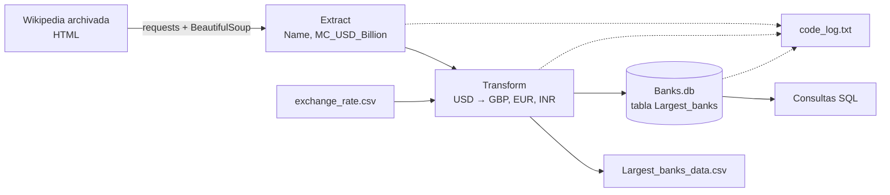

# ETL: los 10 bancos más grandes del mundo

Pipeline ETL en Python que extrae por web scraping el ranking de los bancos más grandes del mundo por capitalización de mercado, convierte los valores de USD a GBP, EUR e INR, y carga el resultado en un CSV y en una base de datos SQLite, con registro de cada etapa en un archivo de log.

> *English summary: Python ETL pipeline that scrapes the world's largest banks by market cap, converts values from USD to GBP, EUR and INR, and loads the results into CSV and SQLite, with stage-by-stage logging.*

## Contexto

Proyecto final del curso **Python Project for Data Engineering** (IBM, Coursera), parte del *IBM Data Engineering Professional Certificate*. El escenario: una organización de investigación necesita un proceso automatizado que se ejecute cada trimestre financiero para preparar un informe con los 10 bancos más grandes y su capitalización en varias monedas.

Sobre la base del curso agregué validación de las respuestas HTTP, manejo de errores con registro en el log, cierre garantizado de la conexión a la base de datos y una estructura con punto de entrada `main()`.

## Flujo del pipeline



| Etapa | Qué hace | Herramientas |
|---|---|---|
| **Extract** | Descarga la página, valida el código HTTP y recorre la tabla *By market capitalization* para obtener nombre y capitalización en USD | `requests`, `BeautifulSoup` |
| **Transform** | Convierte el CSV de tipos de cambio en un diccionario y agrega tres columnas escaladas por cada tasa, redondeadas a 2 decimales | `pandas`, `numpy` |
| **Load** | Guarda el resultado como CSV y como tabla en SQLite (reemplazándola en cada ejecución) | `pandas`, `sqlite3` |
| **Query** | Verifica la carga con tres consultas: tabla completa, promedio en GBP y top 5 | SQL |
| **Log** | Registra cada etapa con marca de tiempo, incluidos los errores | `datetime` |

## Resultados

| Name | USD | GBP | EUR | INR |
|---|---:|---:|---:|---:|
| JPMorgan Chase | 432.92 | 346.34 | 402.62 | 35,910.71 |
| Bank of America | 231.52 | 185.22 | 215.31 | 19,204.58 |
| Industrial and Commercial Bank of China | 194.56 | 155.65 | 180.94 | 16,138.75 |
| Agricultural Bank of China | 160.68 | 128.54 | 149.43 | 13,328.41 |
| HDFC Bank | 157.91 | 126.33 | 146.86 | 13,098.63 |
| Wells Fargo | 155.87 | 124.70 | 144.96 | 12,929.42 |
| HSBC | 148.90 | 119.12 | 138.48 | 12,351.26 |
| Morgan Stanley | 140.83 | 112.66 | 130.97 | 11,681.85 |
| China Construction Bank | 139.82 | 111.86 | 130.03 | 11,598.07 |
| Bank of China | 136.81 | 109.45 | 127.23 | 11,348.39 |

*Capitalización de mercado en miles de millones. Capitalización promedio en GBP: 151.99.*

Los archivos de salida de una ejecución están en [`sample_output/`](sample_output/).

## Cómo ejecutarlo

```bash
git clone https://github.com/JuanDiego076/etl-largest-banks.git
cd etl-largest-banks
pip install -r requirements.txt
python banks_project.py
```

El script busca `exchange_rate.csv` en la carpeta del proyecto y, si no está, lo lee directamente desde la URL del curso. Al terminar genera `Largest_banks_data.csv`, `Banks.db` y `code_log.txt`.

## Manejo de errores

- Las peticiones HTTP tienen tiempo límite y se validan con `raise_for_status()`: una respuesta 4xx o 5xx detiene el proceso en lugar de procesar una página de error.
- Si la página no tiene la tabla esperada, el script falla con un mensaje claro.
- Los errores de red y de procesamiento quedan registrados en `code_log.txt` antes de detener la ejecución.
- La conexión a SQLite se cierra siempre, aunque falle la carga o alguna consulta.

## Estructura

```
etl-largest-banks/
├── banks_project.py      # pipeline ETL completo
├── requirements.txt
├── sample_output/
│   ├── Largest_banks_data.csv
│   └── code_log.txt
└── README.md
```

## Autor

**Juan Diego Taborda Roldán** — Ingeniero de Telecomunicaciones con énfasis en Ciencia de Datos
[LinkedIn](https://www.linkedin.com/in/juandiegotabordaroldan) · [GitHub](https://github.com/JuanDiego076)
